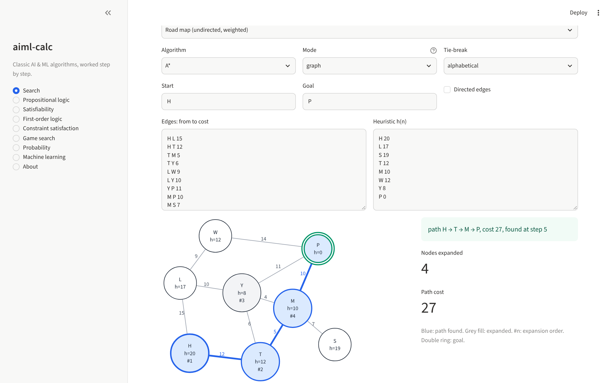
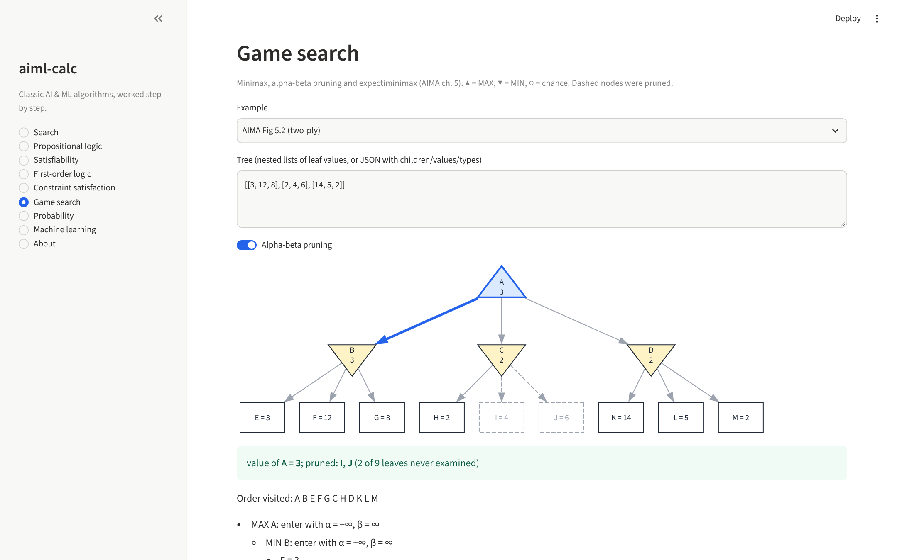
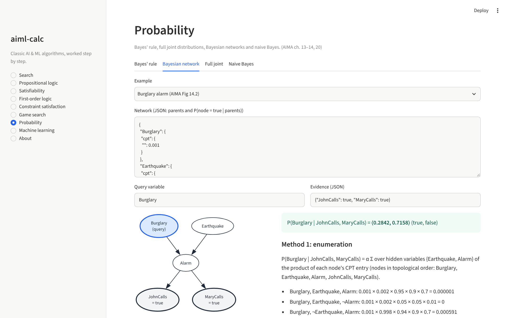
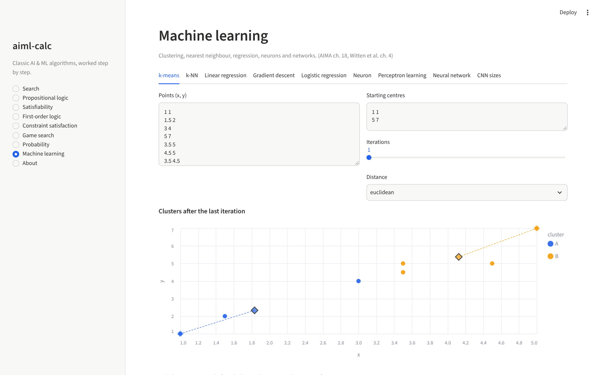

# aiml-calc

Classic AI and machine-learning algorithms, implemented from scratch in pure Python and **worked step by step**: every result comes with the full trace, a second method or independent check where one exists, and the conventions the algorithm used. It follows Russell & Norvig's *Artificial Intelligence: A Modern Approach* (AIMA), with an interactive web UI and an [MCP](https://modelcontextprotocol.io) server so AI assistants can call the same algorithms.

**Try it live:** [aiml.dannypenrose.com](https://aiml.dannypenrose.com). No install needed; the public site turns off the **▶ Run** button, so run the generated code on your own machine.

| | |
|---|---|
|  |  |
|  |  |

## What's inside

| Area | Algorithms |
|---|---|
| **Search** (AIMA ch. 3) | Breadth-first, depth-first, uniform-cost, greedy best-first, A\*, depth-limited, iterative deepening, IDA\*; graph and tree search; heuristic admissibility, consistency and dominance checks |
| **Propositional logic** (ch. 7) | Truth tables and model counting, CNF conversion, entailment by model checking, resolution refutation, forward and backward chaining |
| **Satisfiability** (ch. 7) | DPLL (pure symbol and unit clause rules), WalkSAT |
| **First-order logic** (ch. 9) | Unification with occur check, forward chaining (FOL-FC-ASK), backward chaining with standardising apart |
| **Constraint satisfaction** (ch. 6) | Backtracking with MRV, degree and least-constraining-value heuristics; forward checking; MAC; AC-3 |
| **Game search** (ch. 5) | Minimax, alpha-beta pruning, expectiminimax |
| **Probability** (ch. 13–14, 20) | Bayes' rule, inference from a full joint distribution, Bayesian networks by enumeration, naive Bayes |
| **Machine learning** (ch. 18; Witten et al. ch. 4) | k-means, k-nearest neighbour, least-squares regression, gradient descent, logistic regression, perceptron learning, feed-forward networks with back-propagation, CNN layer sizes |

### Design choices

* **Explain, don't just calculate.** Every view opens with a one-line overview and three panels. *New to this? Start
  here* assumes no background: an everyday analogy, a list of words to know, the steps in plain words, the maths
  explained symbol by symbol, a tiny worked example (every number checked against the implementation) and how the
  work grows as the problem gets bigger. *How it works* is the technical version: key formulas, properties
  (completeness, optimality), a *Cost* section giving time and space complexity with what each variable means,
  pitfalls and the textbook section to read next. *When and where to use this* says when the algorithm is the right tool (and when it
  isn't), with real-world and software-engineering examples. Every input field has a tooltip saying what it means.
* **Explain the answer, not just the method.** Under every answer, *How it got this answer* walks through the
  steps this particular problem took, using its actual numbers: which node was expanded and why, which rule fired,
  how each probability was multiplied and normalised. It connects the general method to the specific result.
* **Show the code.** Every view generates a standalone, readable Python program for the algorithm with the values on
  the page built in. Change an input and the code updates; edit the code and press Run to try your own changes, or
  download it and run it anywhere with no dependencies.
* **Show the working, not just the result.** Each algorithm returns a step-by-step trace (frontier and explored set per step, α and β per node, every arc revision in AC-3, each enumeration term in a Bayes net) as well as the result.
* **Check every result two ways.** CNF is verified against the truth table; resolution against model checking; backward chaining against forward chaining; Bayes-net enumeration against the full joint distribution built from the chain rule; alpha-beta against plain minimax; regression by two closed forms.
* **Make hidden conventions explicit.** Implementations of the same algorithm quietly disagree on when to goal-test, how to break ties, and whether graph search re-adds frontier states. Each of these is a named parameter, and every trace states which convention it used and flags ties.
* **No numerical libraries in the algorithms.** Everything from Gaussian elimination to back-propagation is written out, so the code reads like the textbook pseudocode.

## Setup

You need **Python 3.10 or later** and **git**. Check your Python version with `python3 --version`. On macOS, if it
shows 3.9 or older, install a newer one with `brew install python@3.12` and use `python3.12` in place of `python3`
below.

```bash
git clone https://github.com/<you>/aiml-calc.git
cd aiml-calc
python3 -m venv .venv                 # a private environment inside the project folder
.venv/bin/pip install -e ".[ui]"      # the algorithms, the MCP server and the web UI
```

On Windows, use `.venv\Scripts\` wherever these instructions say `.venv/bin/`.

What gets installed:

| Install | Includes |
|---|---|
| `pip install -e .` | the algorithms and the MCP server (`aiml-calc`) |
| `pip install -e ".[ui]"` | plus the web UI (`aiml-calc-ui`) |
| `pip install -e ".[dev]"` | plus everything needed to run the tests |

## Run

### Web UI

```bash
.venv/bin/aiml-calc-ui
```

This opens **http://localhost:8501** in your browser. Keep the terminal open while you use it, and press **Ctrl+C**
to stop. To use another port: `.venv/bin/aiml-calc-ui --server.port 8600`.

The sidebar groups the 27 views by area (Search, Propositional logic, Satisfiability, …), and every view has its own
address, so you can link straight to one, e.g. **http://localhost:8501/bayes-net** or **/search-trace**. The
sidebar groups open on click, and the search box at the top finds an algorithm by name or keyword (A\*, backprop,
pruning…). The home page has an overview table of when to use each algorithm, with real-world and software examples.

Each view has:

* **Built-in examples** and a tooltip on every field.
* **🌱 New to this? Start here**: the idea in plain words, words to know, the maths, a tiny example and how long it
  takes.
* **📖 How it works (technical)**: formulas, properties, time and space complexity, pitfalls and references.
* **🌍 When and where to use this**: when to reach for it, and real-world and software-engineering uses.
* **🪜 How it got this answer**: a numbered, plain-language walkthrough of how this answer was reached, with the
  actual numbers, followed by the full working.
* **💻 Code** (top right of each page): opens the algorithm as a standalone program with your inputs built in.
  *Edit and run* gives you a syntax-highlighted editor that grows with the code; change it and press **▶ Run**, and the dialog switches to the *Output* tab to show what it printed (runs locally with your Python,
  20-second limit); *Read* shows it with highlighting. **⬇ Download** saves it as a `.py` file that runs with plain
  `python`, no installs needed.

Running code is turned off when the app is deployed publicly (see below), because it would let anyone run code on
the server. The code is still there to read, copy and download.

### As a Python library

```python
from aiml_calc import games, probability

games.alphabeta([[3, 12, 8], [2, 4, 6], [14, 5, 2]])["pruned"]      # ['I', 'J']

burglary = {
    "Burglary": {"cpt": {"": 0.001}}, "Earthquake": {"cpt": {"": 0.002}},
    "Alarm": {"parents": ["Burglary", "Earthquake"], "cpt": {"T,T": 0.95, "T,F": 0.94, "F,T": 0.29, "F,F": 0.001}},
    "JohnCalls": {"parents": ["Alarm"], "cpt": {"T": 0.90, "F": 0.05}},
    "MaryCalls": {"parents": ["Alarm"], "cpt": {"T": 0.70, "F": 0.01}},
}
probability.bayes_net_query(burglary, "Burglary", {"JohnCalls": True, "MaryCalls": True})["distribution"]
# {'true': 0.284..., 'false': 0.715...}
```

Every function also returns a `markdown` field with the full worked trace.

### Run the tests

```bash
.venv/bin/pip install -e ".[dev]"
.venv/bin/pytest
```

### Deploy the web UI

The live site, [aiml.dannypenrose.com](https://aiml.dannypenrose.com), runs on a self-hosted Ubuntu server: Streamlit
on `127.0.0.1:3090` under a hardened systemd unit (`deploy/forge/aiml-calc.service`), Nginx in front
(`deploy/forge/aiml-calc.nginx.conf`) and a Cloudflare Tunnel to the internet. `deploy/forge-setup.sh` installs or
updates all of it and is safe to run twice:

```bash
deploy/forge-setup.sh            # plan: checks everything and changes nothing
deploy/forge-setup.sh --apply    # install or repair, then smoke test
deploy/forge-setup.sh --update   # pull main, reinstall dependencies, restart
```

The repo also works on [Streamlit Community Cloud](https://streamlit.io/cloud), which is free for public
repositories: at [share.streamlit.io](https://share.streamlit.io) choose **Create app**, this repository, branch
`main` and main file `streamlit_app.py`, with Python 3.12 under **Advanced settings**.

Either way the public site sets `AIML_CALC_PUBLIC=1` (`streamlit_app.py` and the systemd unit), which turns off the
**▶ Run** button in the code panels, because running visitors' code on a shared server is not safe. Set
`AIML_CALC_PUBLIC=0` to turn it back on, but only on a server that only you use.

## Use it from Claude (MCP)

The `aiml-calc` command is an [MCP](https://modelcontextprotocol.io) server that gives an AI assistant all 33
algorithms as tools, so it can compute traces and numbers exactly instead of estimating them. It runs locally on your
machine.

First, find the full path to the command (apps launched from the dock don't share your terminal's `PATH`, so they
need the full path):

```bash
echo "$(pwd)/.venv/bin/aiml-calc"
# e.g. /Users/you/dev/aiml-calc/.venv/bin/aiml-calc
```

### Claude Desktop

1. Open **Settings → Developer → Edit Config**. This opens `claude_desktop_config.json`
   (on macOS: `~/Library/Application Support/Claude/claude_desktop_config.json`).
2. Add the server, using your full path. If the file already has an `mcpServers` section, add the `aiml-calc` entry
   inside it.

   ```json
   {
     "mcpServers": {
       "aiml-calc": {
         "command": "/Users/you/dev/aiml-calc/.venv/bin/aiml-calc"
       }
     }
   }
   ```
3. Quit Claude Desktop completely (**Cmd+Q** on macOS) and reopen it.
4. Start a new chat: the aiml-calc tools appear in the tools menu, and **Settings → Developer** shows the server as
   running.

Local servers only work in the Claude Desktop app, not in Claude in the browser.

### Claude Code

```bash
claude mcp add --transport stdio --scope user aiml-calc -- /Users/you/dev/aiml-calc/.venv/bin/aiml-calc
```

`--scope user` makes the tools available in every project; leave it out to add them to the current project only.
Check it worked with `claude mcp list` (it should show `✔ Connected`) or `/mcp` inside a session.

### Try it

Ask something like *"Use aiml-calc to trace A\* from Arad to Bucharest on the Romania map"* or *"Run DPLL on
(A ∨ B), (¬A ∨ B), (¬B ∨ C) with aiml-calc"*. Every result starts with **Answer:** and ends with the conventions the
algorithm used.

### Troubleshooting

| Problem | Fix |
|---|---|
| Server doesn't appear in Claude Desktop | Check the JSON is valid and the path is the full absolute path, then fully quit and reopen the app |
| `spawn … ENOENT` or "command not found" | The path is wrong. Run `ls <your path>` to check the file exists |
| Server fails to start | Run the path directly in a terminal: it should wait silently for input (press Ctrl+C). Any error shown there is the problem |
| Still stuck (macOS) | Read the logs: `tail -n 50 ~/Library/Logs/Claude/mcp-server-aiml-calc.log` |
| `claude mcp list` shows ✘ Failed to connect | Run `claude mcp get aiml-calc` to check the command, and test the path as above |

## Input syntax

* **Propositional formulas:** `¬ ~ !` (not), `∧ &` (and), `∨ |` (or), `⇒ =>` (implies), `⇔ <=>` (iff), with brackets. Clauses can also be written compactly: `Av-BvC`.
* **First-order terms:** variables start lower-case (`x`), constants, functions and predicates upper-case (`Knows(John, Mother(x))`). Rules: `King(x) & Greedy(x) => Evil(x)`.
* **Graphs:** `[[from, to, cost], ...]` (in the UI, one `from to cost` per line).
* **Weights:** bias first, `[w0, w1, ..., wn]`, with a dummy input x₀ = 1.
* **Game trees:** nested lists of leaf values (levels alternate MAX and MIN), or a dict with `children`, `values`, `types` (`max` / `min` / `chance`) and `probabilities`.

## Conventions

| Rule | Default | Parameter |
|---|---|---|
| Goal test | BFS: when a node is generated. Others: when selected | `goal_test` |
| Graph-search duplicates | Not re-added if already in the frontier or explored set; UCS and A\* replace a frontier entry when a cheaper path appears | `mode` |
| Child order | Alphabetical | `child_order` |
| Priority-queue ties | Alphabetical, always flagged | `tie_break` |
| DPLL | Pure symbol rule, then unit clauses in clause order, then branch on the next symbol, true first | `use_pure_symbols`, `true_first`, `symbol_order` |
| CSP variable / value order | MRV with degree tie-break / least constraining value | `variable_order`, `value_order` |
| Alpha-beta | Children searched left to right | – |
| Hard threshold | 1 when the linear input is ≥ 0 | – |
| Gradient descent | Factor 2 folded into α, as in AIMA | `fold_two` |

## How it is tested

```bash
pip install -e ".[dev]"
pytest
```

233 tests:

* **Reference cases** reproduce textbook results: the crime knowledge base proved in two rounds of forward chaining, the Australia map colouring starting from SA, two leaves pruned in AIMA Fig 5.5, P(Burglary | both neighbours call) ≈ 0.284, P(Cavity | toothache) = 0.6, and more.
* **Property tests** compare each algorithm with an independent method on hundreds of random inputs: DPLL and three backtracking configurations against brute force, resolution against truth tables, A\* and IDA\* against uniform-cost search, alpha-beta against minimax, back-propagation against a numerical gradient.
* **Generated code tests** run every view's Python program, with several different inputs each, and check it prints the same answer as the library.
* **Walkthrough tests** check that the numbers in the step-by-step explanations agree with the algorithms (for example, the replayed perceptron updates end at the library's weights, and the naive Bayes scores normalise to its posterior).
* **UI tests** render every page and every built-in example headlessly, open the code dialog and press Run, and check that every view has its three explanation panels, its walkthrough and its code button, and that every input field has a tooltip.

## Limitations

* Sized for small, hand-checkable problems: truth tables, resolution and Bayes-net enumeration are exponential by design.
* Bayesian networks are Boolean-only; CSP constraints are binary.

## License

MIT © Danny Penrose
